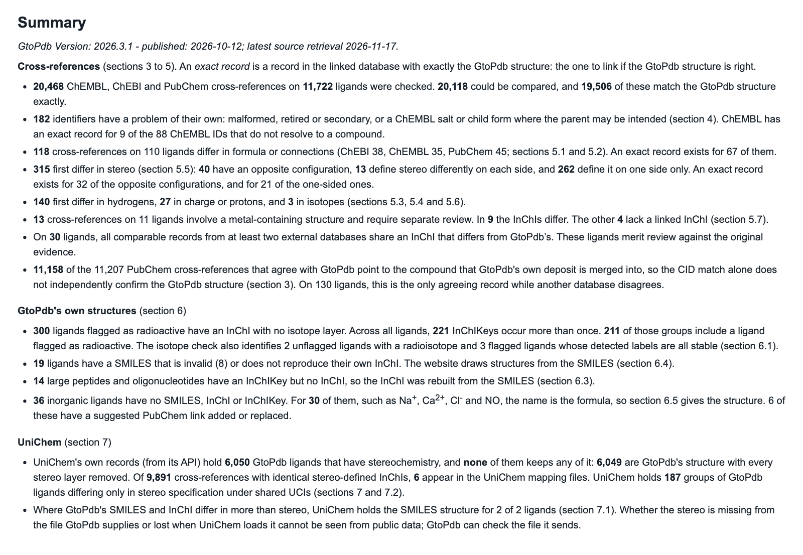
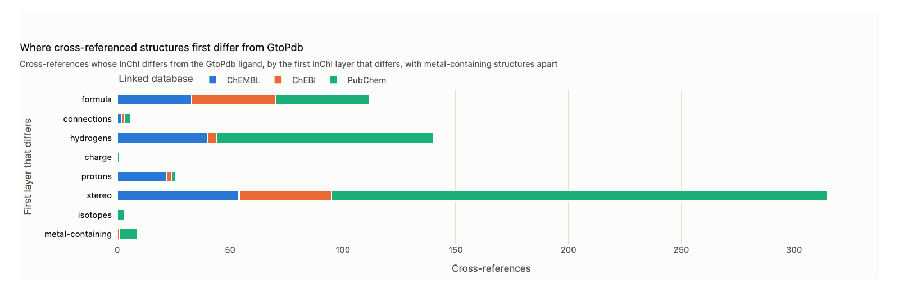
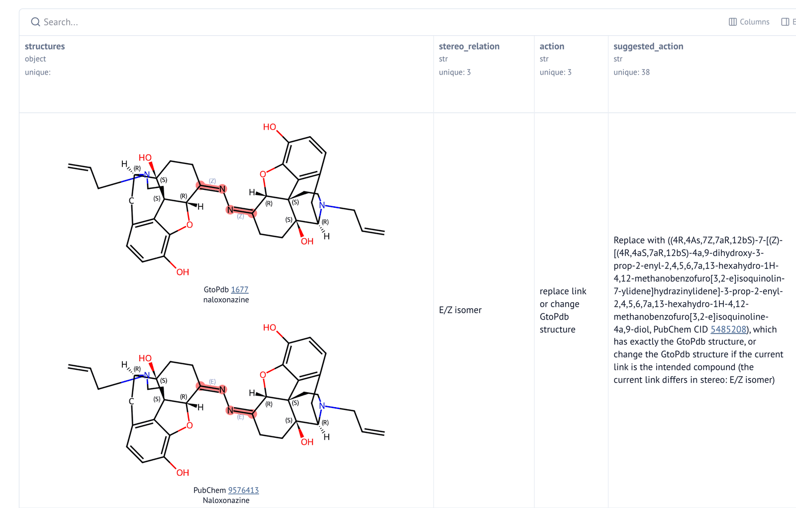
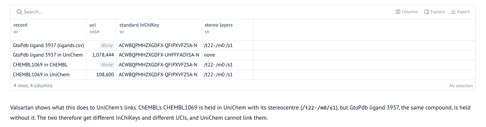

# GtoPdb cross-reference structure audit

[](https://molab.marimo.io/github/ali-zaeim/GtoPdb_chemistry_audit/blob/main/gtp_chemistry_problem.py)

A [marimo](https://marimo.io) notebook that checks the ChEMBL, ChEBI and PubChem identifiers the
[IUPHAR/BPS Guide to PHARMACOLOGY](https://www.guidetopharmacology.org) (GtoPdb) assigns to its ligands. For every
cross-reference it compares the standard InChI of the GtoPdb ligand with the one held by the linked database, and
lists the discrepancies with a suggested action for curators. It also explains why GtoPdb ligands do not match their
ChEMBL, ChEBI and PubChem records in UniChem.

## What it shows

The notebook opens with a summary of its findings for the cached GtoPdb 2026.3.1 release. Of 20,468 cross-references on
11,722 ligands, 20,118 had two standard InChIs to compare. Of these, 19,506 matched exactly and 612 differed.
The remaining 350 could not be compared. Section 3.1 lists the 184 links otherwise absent from the findings tables
and shows which record lacks a standard InChI. Agreement across databases can guide a curator to the primary
evidence for the intended compound.



Each cross-reference is compared by reading the two standard InChIs layer by layer (formula, connections, hydrogens,
charge, protons, stereo, isotopes) and stopping at the first layer that differs.



Every cross-reference that differs is listed with both structures drawn, the GtoPdb ligand above the linked record,
and the atoms that differ highlighted. Each also gets a suggested action for curators. Diadenosine diphosphate (ligand
1065), for example, is the 5′,3′-linked compound in GtoPdb, but its ChEBI link is the 5′,5′-linked one; ChEBI has
another entry with exactly the GtoPdb structure.


Stereo differences are labelled R/S and E/Z. Naloxonazine (ligand 1677) has both its C=N double bonds Z in GtoPdb,
but E in its PubChem link.



Of 6,050 stereo-defined GtoPdb ligands found in the cached UniChem API records, all 6,050 lacked stereo layers
there. For 6,049, removing stereo from the GtoPdb InChI reproduced the full UniChem InChI. The mapping files
contained six of the 9,891 GtoPdb cross-references with identical stereo-defined InChIs. All six were PubChem links.



## Running it

The molab link above opens a read-only preview of the notebook with its outputs, from the session snapshot in
`__marimo__/session/`; in the preview, each table shows its first 10 rows. To run it, choose **Run** or fork it in
molab, or, with [uv](https://docs.astral.sh/uv/) installed, run the notebook file on its own:

```bash
uvx marimo edit --sandbox gtp_chemistry_problem.py
```

The notebook is self-contained. It declares its dependencies inline (PEP 723), which a sandbox installs, and defines
every function it uses in its appendix, as marimo top-level functions. The tests import those functions from the
notebook file. To work on it from a clone of this repository:

```bash
uv run marimo edit --no-sandbox gtp_chemistry_problem.py   # open it to edit
uv run marimo run --no-sandbox gtp_chemistry_problem.py    # open it as an app
uv run pytest                                              # run the tests
```

`uv run` uses the project's environment: the same dependencies, from `pyproject.toml`, plus pytest and ruff.
`--no-sandbox` stops marimo asking whether to create a sandbox instead. `gtp_chemistry_problem.css` sits next to the
notebook and is loaded by it (`css_file`); it lets text wrap in narrow table columns.

## Data

Everything comes from public sources:

- **GtoPdb**: the download files [`ligands.csv`](https://www.guidetopharmacology.org/DATA/ligands.csv) and [`ligand_id_mapping.csv`](https://www.guidetopharmacology.org/DATA/ligand_id_mapping.csv)
- **UniChem**: the [`wholeSourceMapping`](https://ftp.ebi.ac.uk/pub/databases/chembl/UniChem/data/wholeSourceMapping/) flat files, plus the UniChem API
- **ChEMBL, ChEBI and PubChem**: their public APIs

Downloads and API responses are cached under `data/raw_data/gtp_xref_audit/`, so later runs only fetch identifiers
that are not cached yet. Where that cache is missing, for example when the notebook runs on molab without the rest of
this repository, the notebook first copies the cache committed here (about 17 MB) from GitHub, so it reproduces the
published results without querying the APIs. Tick **Re-download all source data** in the notebook to fetch current
data instead: about 10 MB of files, a few hundred ChEMBL, ChEBI and PubChem requests, and one UniChem request per
GtoPdb ligand (about 14,000), which takes around 15 minutes in all.

## Output

Result tables are written to `data/processed_data/gtp_xref_audit/`, named after the GtoPdb release. The curation file
(`…__curation_issues.csv`) has one row per cross-reference that needs attention, with the first InChI layer that differs and a suggested action.

## License

The code is released under the [MIT License](LICENSE). The data it downloads remain under the terms of their
sources (GtoPdb, UniChem, ChEMBL, ChEBI and PubChem).
